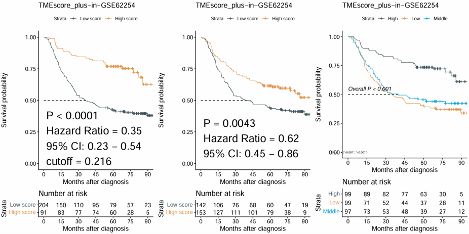

# Data preprocessing and benchmark resources

This chapter provides the scripts and input/output resources used to prepare the GSE62254 expression and survival data and to support the task-level comparison between local IOBR and IOBRportal.

## GSE62254 data preparation

### Data sources

The GSE62254 cohort contains microarray expression profiles from 300 gastric tumor samples generated using the Affymetrix Human Genome U133 Plus 2.0 Array (GPL570).

- **Expression data:** Open the [GSE62254 GEO accession page](https://www.ncbi.nlm.nih.gov/geo/query/acc.cgi?acc=GSE62254), locate **Series Matrix File(s)** under **Download family**, and download `GSE62254_series_matrix.txt.gz`.
- **Clinical and survival data:** Download the supplementary spreadsheet [`41591_2015_BFnm3850_MOESM34_ESM.xls`](https://static-content.springer.com/esm/art%3A10.1038%2Fnm.3850/MediaObjects/41591_2015_BFnm3850_MOESM34_ESM.xls) associated with the [original publication](https://www.nature.com/articles/nm.3850).
- **Processed survival data:** [Download `GSE62254_survival_data.xlsx`](data/GSE62254_survival_data.xlsx).

Place the downloaded Series Matrix file and original supplementary spreadsheet in the working directory before running the following code.

### Expression-matrix preparation

```{r gse62254-expression-preparation, eval=FALSE}
library(GEOquery)

# Read the locally downloaded Series Matrix file
gse62254 <- getGEO(
  filename = "GSE62254_series_matrix.txt.gz",
  getGPL   = FALSE
)

# Extract the probe-level expression matrix
eset_probe <- Biobase::exprs(gse62254)

# Inspect the data
dim(eset_probe)
eset_probe[1:5, 1:5]

# Save the probe-level expression matrix
write.csv(
  eset_probe,
  file      = "GSE62254_probe_expression.csv",
  row.names = TRUE,
  quote     = FALSE
)
```

The resulting probe-level expression matrix can be uploaded to the **Integrated Workflow** in IOBRportal. Probe annotation, duplicated-gene handling, optional log transformation, and outlier detection can then be completed within the platform.

### Clinical and survival-data preparation

```{r gse62254-survival-preparation, eval=FALSE}
library(GEOquery)
library(readxl)
library(dplyr)
library(writexl)

# Read the locally downloaded Series Matrix file
gse62254 <- getGEO(
  filename = "GSE62254_series_matrix.txt.gz",
  getGPL   = FALSE
)

# Extract sample phenotype information from GEO
pheno <- Biobase::pData(gse62254)

# Read the clinical and survival data from the original supplement
clin <- read_excel("41591_2015_BFnm3850_MOESM34_ESM.xls")

dim(clin)
names(clin)

# Rename the required columns
column_map <- c(
  "Tumor ID" = "Tumor_ID",
  "Sample\nName" = "Sample_Name",
  "documented recurrence no=0  yes=1 unknown=2" = "Recurrence",
  "FU status0=alive without ds, 1=alive with recurren ds, 2=dead without ds, 3=dead d/t recurrent ds, 4=dead, unknown, 5= FU loss" = "FU_status",
  "DFS\n(months)" = "DFS_time",
  "OS\n(months)" = "OS_time",
  "Mol. Subtype: 0=MSS/TP53-, 1=MSS/TP53+, 2 = MSI, 3= EMT" = "Subtype",
  "EBV ISH\n0: negative\n1: positive\nNA: Not available (no available tumor blocks)" = "EBV_raw",
  "WHO 1=w/d adeno\n2=m/d adeno\n3=p/d adeno\n4=signet ring\n5= mucinous\n6=papillary adeno\n7=adenosquamous\n8=undifferentiated ca\n9=hepatoid adenoca\n10=tubular adenoca\n11=others (text)" = "WHO_raw",
  "LAUREN 1=intestinal, 2=diffuse, 3=mixed" = "Lauren_raw",
  "Perineural Invasion(PNI) 0=(-), 1=(+), blank (not reported)" = "PNI_raw"
)

column_index <- match(names(column_map), names(clin))
matched_columns <- !is.na(column_index)
names(clin)[column_index[matched_columns]] <- unname(column_map[matched_columns])

# Prepare sample identifiers
pheno$sample_id <- rownames(pheno)
pheno$Tumor_ID <- as.numeric(gsub("[^0-9]", "", pheno$title))
clin$Tumor_ID <- as.numeric(clin$Tumor_ID)

# Match GEO samples with the clinical supplement
dat <- merge(
  pheno,
  clin,
  by     = "Tumor_ID",
  all.x  = TRUE,
  sort   = FALSE
)

dat <- dat[match(pheno$Tumor_ID, dat$Tumor_ID), ]
rownames(dat) <- dat$sample_id

# Select the variables used in downstream analyses
surv_df <- dat[, c(
  "sex", "Recurrence", "pStage", "FU_status", "DFS_time", "OS_time",
  "Subtype", "WHO_raw", "EBV_raw", "Lauren_raw", "PNI_raw"
)]

# Convert variable types
surv_df$sex <- as.character(surv_df$sex)
surv_df$pStage <- as.character(surv_df$pStage)
surv_df$pStage[surv_df$pStage == "①II/ ②I/ ③I"] <- "II"
surv_df$pStage[surv_df$pStage == "①III/ ②II"] <- "III"

numeric_variables <- c(
  "Recurrence", "FU_status", "DFS_time", "OS_time",
  "Subtype", "WHO_raw", "EBV_raw", "Lauren_raw", "PNI_raw"
)

surv_df[numeric_variables] <- lapply(
  surv_df[numeric_variables],
  as.numeric
)

# Recode EBV status
surv_df$EBV <- ifelse(
  surv_df$EBV_raw == 1,
  "positive",
  ifelse(surv_df$EBV_raw == 0, "negative", NA)
)

# Recode WHO histological type
surv_df$WHO <- case_when(
  surv_df$WHO_raw == 1  ~ "w/d adeno",
  surv_df$WHO_raw == 2  ~ "m/d adeno",
  surv_df$WHO_raw == 3  ~ "p/d adeno",
  surv_df$WHO_raw == 4  ~ "signet ring",
  surv_df$WHO_raw == 5  ~ "mucinous",
  surv_df$WHO_raw == 6  ~ "papillary adeno",
  surv_df$WHO_raw == 7  ~ "adenosquamous",
  surv_df$WHO_raw == 8  ~ "undifferentiated ca",
  surv_df$WHO_raw == 9  ~ "hepatoid adenoca",
  surv_df$WHO_raw == 10 ~ "tubular adenoca",
  surv_df$WHO_raw == 11 ~ "others",
  TRUE ~ NA_character_
)

# Recode Lauren classification
surv_df$Lauren <- case_when(
  surv_df$Lauren_raw == 1 ~ "intestinal",
  surv_df$Lauren_raw == 2 ~ "diffuse",
  surv_df$Lauren_raw == 3 ~ "mixed",
  TRUE ~ NA_character_
)

# Recode perineural invasion status
surv_df$PNI <- ifelse(
  surv_df$PNI_raw == 1,
  "positive",
  ifelse(surv_df$PNI_raw == 0, "negative", NA)
)

# Create survival-event variables
surv_df$OS_status <- ifelse(
  surv_df$FU_status %in% c(2, 3, 4),
  1,
  ifelse(surv_df$FU_status %in% c(0, 1, 5), 0, NA)
)

surv_df$DFS_status <- ifelse(
  surv_df$Recurrence == 1,
  1,
  ifelse(surv_df$Recurrence == 0, 0, NA)
)

# Recode molecular subtypes
subtype_labels <- c("MSS/TP53-", "MSS/TP53+", "MSI", "EMT")
surv_df$Subtype <- subtype_labels[surv_df$Subtype + 1]

# Prepare the final output table
surv_output <- data.frame(
  ID = rownames(surv_df),
  surv_df[, c(
    "sex", "pStage", "Subtype", "WHO", "EBV", "Lauren", "PNI",
    "OS_time", "DFS_time", "OS_status", "DFS_status"
  )],
  row.names = NULL,
  check.names = FALSE
)

# Save the processed survival table as an Excel file
if (!dir.exists("data")) {
  dir.create("data", recursive = TRUE)
}

write_xlsx(
  surv_output,
  path = "data/GSE62254_survival_data.xlsx"
)
```

The `ID` column contains the GEO sample identifiers and is used to match the survival table with the expression matrix in IOBRportal.


## Task-level benchmark preparation

### Benchmark design

This example illustrates the additional preparation required to complete the GSE62254 analysis using local IOBR. Users needed to consult the relevant documentation, install and configure R and the required dependencies, write and refine the analysis code, organize successive analytical steps, and manually manage intermediate results. These tasks required programming experience and additional preparation time before the analysis could be completed.

In contrast, IOBRportal organized the same procedure—including expression preprocessing, GPL570 probe annotation, outlier detection, ssGSEA-based TME signature scoring, data integration, and TMEscore_plus survival analysis—into a guided workflow with automatic transfer of upstream results and direct result export.

Because IOBRportal calls the same underlying IOBR functions, the comparison was designed to assess result consistency and workflow organization rather than differences in computational speed. The required input files are:

- `GSE62254_probe_expression.csv`, generated using the expression-preparation code above
- [`GSE62254_survival_data.xlsx`](data/GSE62254_survival_data.xlsx), generated using the clinical-data preparation code above

### Local IOBR analysis

```{r gse62254-local-iobr-benchmark, eval=FALSE}
# Install the required packages before the first run if necessary
# install.packages(c("IOBR", "readxl", "tibble"), dependencies = TRUE)

library(IOBR)

# Read the probe-level expression matrix
eset <- read.csv(
  "GSE62254_probe_expression.csv",
  row.names   = 1,
  check.names = FALSE
)

eset <- as.matrix(eset)

# Read the processed clinical and survival data
pdata <- readxl::read_excel(
  "data/GSE62254_survival_data.xlsx"
) |>
  as.data.frame()

head(pdata)

# Determine whether log2 transformation is required
eset <- log2eset(eset)

# Annotate GPL570 probes to gene symbols
anno_hug133plus2 <- load_data("anno_hug133plus2")

eset <- anno_eset(
  eset       = eset,
  annotation = anno_hug133plus2,
  symbol     = "symbol",
  probe      = "probe_id",
  method     = "mean"
)

# Identify potential outlier samples
outlier_samples <- find_outlier_samples(
  eset      = eset,
  project   = "ACRG",
  show_plot = TRUE
)

outlier_samples

# Remove the identified outlier samples
eset <- eset[
  ,
  !colnames(eset) %in% outlier_samples,
  drop = FALSE
]

dim(eset)

# Calculate TME signature scores using ssGSEA
signature <- load_data("signature_tme")

sig_tme <- calculate_sig_score(
  pdata           = NULL,
  eset            = eset,
  signature       = signature,
  method          = "ssgsea",
  mini_gene_count = 3
)

# Convert the result to a signature-by-sample matrix
sig_tme <- t(
  tibble::column_to_rownames(
    sig_tme,
    var = "ID"
  )
)

# Confirm that TMEscore_plus is present
"TMEscore_plus" %in% rownames(sig_tme)

# Integrate signature scores with the survival data
input_survival <- combine_pd_eset(
  eset                 = sig_tme,
  pdata                = pdata,
  id_pdata             = "ID",
  feature_manipulation = FALSE,
  scale                = FALSE
)

head(input_survival)

# Perform Kaplan-Meier analysis for TMEscore_plus
km_result <- sig_surv_plot(
  input_pdata = input_survival,
  signature   = "TMEscore_plus",
  project     = "GSE62254",
  ID          = "ID",
  time        = "OS_time",
  status      = "OS_status",
  time_type   = "month",
  save_path   = NULL
)

km_result$plots
```

**Output**



### Task-level comparison

**Task-level comparison of local IOBR and IOBRportal using the GSE62254 workflow**

| Item | Local IOBR 2.0 | IOBRportal |
|:--|:--|:--|
| Input data | GSE62254 expression and survival data | Same |
| IOBR version and parameters | Identical | Identical |
| Analytical procedure | Annotation, outlier detection, ssGSEA scoring, data integration, and survival analysis | Same |
| TMEscore_plus results | Consistent | Consistent |
| Survival-analysis results | Consistent | Consistent |
| Computational time | Comparable | Comparable |
| R installation | Required | Not required |
| Dependency installation | Required | Not required |
| Documentation consultation | Required for workflow construction | Integrated guidance provided |
| User-written code | Required | Not required |
| Continuous workflow construction | Manually written and refined | Built-in guided workflow |
| Intermediate-result coordination | Managed by the user in code | Automatically transferred |
| Intermediate-result export | Implemented by the user | Direct download |
| Final-result export | Implemented by the user | Direct download |
