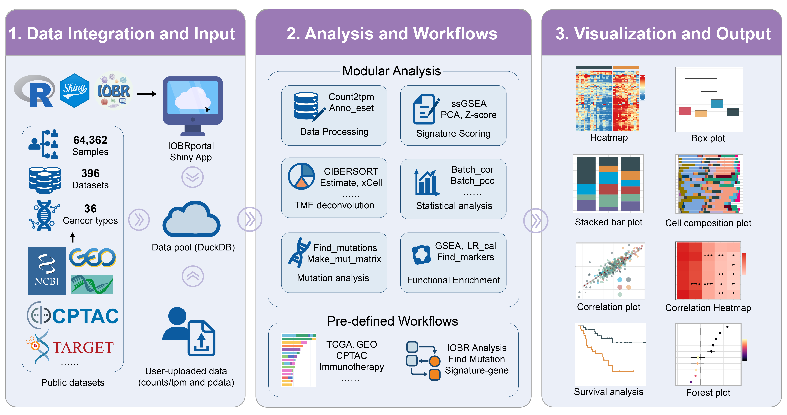

# IOBRportal framework

```{r overview, echo=FALSE, fig.align='center', out.width='100%', fig.cap='Overview of the IOBRportal platform.'}

```

## 📚 Introduction

IOBRportal is a Shiny-based, cloud-deployable platform built within the IOBR ecosystem for bulk transcriptome and immuno-oncology research. It integrates **curated public cohorts** with **user-uploaded datasets** and provides two complementary analysis modes:

- 🧩 **Functions** — flexible, module-level analyses
- 🔄 **Workflows** — guided pipelines with automatic reuse of upstream results

Within a unified interface, IOBRportal connects data preparation, signature scoring, tumor microenvironment (TME) deconvolution, clustering, mutation analysis, statistical testing, visualization, and result export.

The current version incorporates **64,362 samples**, **396 datasets**, and **36 cancer types**. Curated resources are organized into four entry categories:

| Entry | Resource type |
|:--|:--|
| 🧬 **TCGA** | TCGA transcriptomic, clinical, TME, signature, and mutation resources |
| 💉 **IMMC** | Curated immunotherapy cohorts |
| 🎗️ **MOLC** | Curated cancer cohorts, primarily derived from GEO |
| 🧫 **CLIC** | CPTAC and TARGET cohorts |

## 🔄 Analysis workflow

```{r workflow, echo=FALSE, fig.align='center', out.width='100%', fig.cap='Integrated analysis workflow of IOBRportal.'}
knitr::include_graphics("fig/IOBRportal_workflow.png")
```

The platform provides three principal user-uploaded data workflows:

- 🧬 **Integrated Workflow** — expression preprocessing, signature scoring or TME deconvolution, clustering, phenotype integration, and downstream analysis
- 🧫 **Mutation Workflow** — mutation-matrix construction, mutation association analysis, visualization, and survival analysis
- 🔗 **Signature-Gene Workflow** — expression preprocessing, signature estimation, and signature-gene correlation analysis

## 🚀 Access IOBRportal

| Mode | Access |
|:--|:--|
| 🌐 **Primary server** | [https://iobr.github.io/IOBRportal/](https://iobr.github.io/IOBRportal/) |
| 🌐 **Backup server** | [https://lisom.work/shinyapps/IOBRportal/](https://lisom.work/shinyapps/IOBRportal/) |
| 📦 **R package** | [https://github.com/IOBR/IOBRportal](https://github.com/IOBR/IOBRportal) |
| 📖 **Documentation** | [https://qingcongl.github.io/IOBRportal_book/](https://qingcongl.github.io/IOBRportal_book/) |

To install and run IOBRportal locally:

```r
if (!requireNamespace("remotes", quietly = TRUE)) {
  install.packages("remotes")
}

remotes::install_github("IOBR/IOBRportal", dependencies = TRUE)

library(IOBRportal)
run_iobrportal()
```

> The local R package supports upload-based workflows. Database-backed cohort resources are available through the fully configured online deployment.

## 📖 About this book

This book provides:

- installation and deployment instructions
- module and parameter descriptions
- user-uploaded data requirements
- workflow-based tutorials
- representative analysis examples
- result interpretation and export guidance

## 💿 License

IOBRportal is released under the GNU General Public License v3.0. See **LICENSE** for details.

The online version of this book is licensed under the [Creative Commons Attribution-NonCommercial-ShareAlike 4.0 International License](https://creativecommons.org/licenses/by-nc-sa/4.0/).

## 🏆 Citations

If you use IOBR ecosystem in your research, please cite the relevant computational methods, and the following IOBR ecosystem papers:

1. Zeng D, Fang Y, et al. **Enhancing immuno-oncology investigations through multidimensional decoding of tumor microenvironment with IOBR 2.0.** *Cell Reports Methods*. 2024;4:100910. [doi:10.1016/j.crmeth.2024.100910](https://doi.org/10.1016/j.crmeth.2024.100910)

2. Fang Y, Kong Y, Rong G, Luo Q, Liao W, Zeng D. **Systematic investigation of tumor microenvironment and antitumor immunity with IOBR.** *Med Research*. 2025;1(1):136–140. [doi:10.1002/mdr2.70001](https://doi.org/10.1002/mdr2.70001)

## ✉️ Reporting bugs

Report bugs or request features through [GitHub Issues](https://github.com/IOBR/IOBRportal/issues).

E-mail questions to:

- **Qingcong Luo**: [qingcongl@163.com](mailto:qingcongl@163.com)
- **Dr. Dongqiang Zeng**: [interlaken@smu.edu.cn](mailto:interlaken@smu.edu.cn)